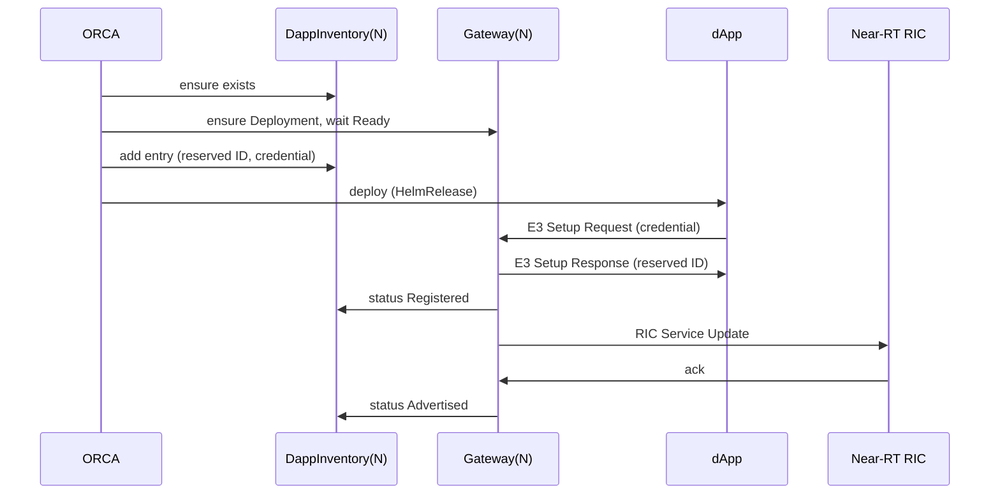

# ORCA dApp lifecycle with the Gateway RAN Function

Status: agreed design (brainstorm of 2026-11-18 and 2026-11-24). ORCA side implemented on branch feat/dapp-inventory. Gateway not implemented yet.

## Goal

Keep the dApp inventory consistent between the SMO (ORCA) and the Near-RT RIC. A dApp is only advertised to the RIC after ORCA has deployed it, and it is withdrawn from the RIC before ORCA removes it.

## Scope

ORCA monitors only what it deploys: dApps and Gateways. It never manages nodes, the CU/DU, or the RIC.

## Components

**DappManifest (existing CR, `cache.orca.com`).** The declarative intent for one dApp on one node.

**Gateway RAN Function.** Two parts:
- A thin, generic hook built into the CU/DU. It is not managed by ORCA.
- The Gateway logic, which runs as a dedicated pod managed by ORCA on the same node. It does not run as a container in the CU/DU pod, because changing that pod would restart the cell.

It terminates E3 for the dApps on its node and advertises them to the RIC via RIC Service Update (E2SM-DAPP).

**DappInventory (new CR, one per node, name = node name).**
- `spec`, written by ORCA: the dApps on the node. Each entry has the DappManifest reference, the reserved dApp ID, the credential reference, and an entry generation.
- `status`, written by the Gateway: per dApp, whether it is Registered and Advertised. The Gateway confirms a withdrawal by deleting the dApp's status entry.

Gateway contract (the ORCA side relies on all four rules):
1. **Entry before anything in flight.** The Gateway writes a status entry (`registered: false`) before it accepts an E3 Setup or starts any RIC Service Update for that ID. Then "no status entry" always means "nothing in flight".
2. **Withdraw, then remove.** When a dApp leaves the spec, the Gateway un-advertises it (or cancels an add still in flight), closes its E3 session, and only then removes its status entry.
3. **Level-based.** Any status entry whose ID has no spec entry is withdrawn and removed, including entries found after a Gateway restart. An orphan entry would otherwise block every deletion on the node.
4. **Conditional writes.** Every status write is conditional on the `resourceVersion` the Gateway read. A write based on a spec that no longer holds the ID fails, so a late write cannot recreate a removed entry.

RBAC is split: ORCA writes `spec`, and the Gateway may only get and watch the CR and patch `dappinventories/status`.

Why a CRD and not a ConfigMap:
- A mounted ConfigMap can lag about 60s, which breaks the inventory-before-deploy ordering.
- The Gateway needs a write-back path for the deletion finalizer.
- A CRD gives a typed schema.

## Invariants

1. A Gateway runs on node N if and only if at least one dApp is placed on N.
2. A dApp is in the DappInventory of N before its pod exists, and stays there until it is un-advertised.
3. The dApp ID is unique per node and is the same in ORCA's inventory and in what the RIC sees.

## Placement

- Gateway-backed dApps are pinned to one node with `nodeName`. `nodeSelector` is removed from DappManifestSpec, and `tolerations` stays.
- There is one DappManifest per node, with no fan-out from labels.
- Scalability: controller-runtime is event-driven, and the per-node inventory lookup uses a cache field index. Raise `MaxConcurrentReconciles`.

## dApp ID ownership

- No normative O-RAN TS defines a dApp ID. The nGRG RR-2025-05 (§4.4.1) and dApp-framework (`E3-SetupResponse.dAppIdentifier`) have the RAN function return the ID in the E3 Setup Response.
- ORCA reserves the ID (unique per node) and stores it in the DappInventory.
- The dApp is not given its ID. It gets a credential, which it sends in the E3 Setup Request (the "security authentication parameters" field).
- The Gateway looks the credential up in the inventory and returns the reserved ID in the E3 Setup Response. Unknown credentials are rejected.

This keeps the nGRG flow (the RAN function hands out the ID), while ORCA guarantees consistency.

The credential is a token:
- ORCA generates a random token per inventory entry generation and stores it in a Secret mounted into the dApp pod. DappInventory.spec keeps only its hash.
- The Gateway hashes the received token and compares it with the hash in the inventory.

How the token reaches the dApp:
- **Packaging contract.** ORCA passes the Secret name to the dApp chart as the Helm value `orca.e3TokenSecret`. The chart mounts it at the fixed path `/var/run/orca/e3/token`. This is about six lines of YAML in the chart and no dApp code.
- **E3 client library.** The E3 client library (dApp-libe3 / dApp-library) reads that path and sends the token in the E3 Setup Request. dApp authors write nothing.
- **Justification.** The nGRG RR-2025-05 dApp deployment use case, step 7, assigns this to the SMO: "The SMO sets up the initial configuration for the dApp, such as environment variables, network policies, and access parameters." Step 4 already requires dApps to be packaged and cataloged with a descriptor.
- **Future work.** A mutating admission webhook in ORCA could inject the volume and remove the chart convention entirely, in the same pattern as Istio's sidecar injection. It is not done in the prototype, because of the cost of certificates, pod selection, and one more failure point.

Why a token and not just a name:
- A name is enough to map a connection to an inventory entry. It does not stop any process that reaches the Gateway's IPC channel from claiming to be that dApp, receiving its ID, subscribing to telemetry, and sending control actions.
- E3 is a trust boundary between third-party code and the RAN.
- On update, ORCA rotates the token, so the old pod is rejected during a rolling update.

How rotation works:
- **Triggers.** ORCA rotates the token when one of these holds: the entry is missing, the current token Secret is missing, the DappManifest's generation changed, or the Secret's token does not match the stored hash. ORCA reads Secrets directly from the API server, not from a cache, so a stale cache cannot trigger a rotation by mistake.
- **A new Secret per rotation.** Each rotation creates a new Secret named `<namespace>-<name>-e3-<first 10 hex of the hash>`. The Helm value `orca.e3TokenSecret` therefore changes, and Flux rolls the dApp pod. The old pod keeps its old token, which no longer matches, so the Gateway rejects it. The old Secrets of the same dApp are deleted only after the HelmRelease points to the new one.
- **The entry generation counts rotations.** `DappInventoryEntry.generation` starts at 1 and goes up by 1 on every rotation. A freed dApp ID is reused only after the Gateway has removed its status entry, so a stale status cannot be mistaken for a new dApp.
- **A dApp ID is not reused while it is still in use on the RIC side.** An ID that still has a Gateway status entry is not free for allocation, even after its spec entry is removed. The RIC never sees one ID for two dApps at once. `Registered` and `Advertised` count only when the Gateway's status generation matches, so they reset on every rotation, not only on spec changes.
- **`spec.namespace` is immutable**, like `nodeName`, so no Secret can be orphaned in an earlier namespace. The SMO's Deployment ID (nGRG deploy use case, steps 9 and 10) is a separate identifier.

## Gateway deployment

- ORCA creates a Deployment (`replicas: 1`, `nodeName` = N), whose ownerReference is the DappInventory of N.
- When the last dApp leaves N, ORCA deletes the DappInventory, and garbage collection removes the Gateway. Invariant 1 therefore holds by construction.
- ORCA reads Gateway readiness from the Deployment status. No Flux is involved for the Gateway.
- The Gateway image and config come from ORCA flags/config (one global value, no new CRD).
- The Gateway pod uses a ServiceAccount and gets its node name via the Downward API (`spec.nodeName`). It watches only its own DappInventory.

Gateway implementation:
- **Language:** C++, built on `dApp-libe3` (the `E3Agent` class is the RAN side of E3, with ASN.1 APER encoding and ZMQ over IPC).
- **Kubernetes client:** minimal, written with libcurl plus a JSON parser. It reads the ServiceAccount token and CA, runs a list + watch loop on `DappInventory/<node>` (re-list on error or `410 Gone`), and PATCHes `dappinventories/status`.
- **Rejected alternatives:**
  - kubernetes-client/c: little used, and untyped for CRDs.
  - Go: client-go is free, but E3 would need cgo or a reimplementation of E3AP/APER.
  - A Go sidecar for Kubernetes: it adds an internal protocol to maintain.

Rejected alternatives:
- **HelmRelease per node:** the Gateway is ORCA's own component, so a chart adds indirection and Ready latency.
- **DaemonSet:** it needs node labels, and ORCA must not touch nodes.

## Lifecycle

### Create (DappManifest for node N)

### Delete (finalizer on DappManifest)

1. Remove the dApp's entry from DappInventory(N).spec.
2. Wait until the Gateway confirms the withdrawal by removing the dApp's status entry. `Advertised=false` alone is not enough, because an add may still be in flight.
3. Delete the dApp's token Secrets.
4. If it was the last dApp on N, wait until the inventory status is empty, then delete DappInventory(N). Garbage collection then removes the Gateway.
5. Remove the finalizer. Garbage collection then removes the HelmRelease and with it the dApp pod, which is safe because the dApp is already withdrawn.

Two more rules keep step 4 safe:
- **When the inventory is deleted.** Step 4 applies only when both the spec and the status are empty. While the spec is empty but the status is not, every deleting dApp on the node keeps waiting. The last one to see an empty status deletes the inventory. This way the Gateway is never removed while a withdrawal is still in progress, and no Gateway is left behind on a node without dApps.
- **A reused dApp ID.** While a deleting dApp waits, its ID may already belong to another dApp's spec entry. In that case its own withdrawal already happened, so it does not wait.

Known limitations of the delete flow:
- **Foreground cascade or namespace deletion.** Both remove the HelmRelease, and with it the dApp pod, before the Gateway confirms the un-advertise. This happens with `kubectl delete --cascade=foreground`, when the DappManifest's namespace is deleted, and when the dApp's target namespace (`spec.namespace`) is deleted. Ordinary (background) deletion of a DappManifest is safe. Dropping the HelmRelease ownerReference and deleting it explicitly after the wait would fix the foreground case only. The namespace cases would need an admission check that blocks namespace deletion while dApps in it are still advertised. A finalizer on the HelmRelease does not help, because Flux uninstalls the release as soon as deletion starts.
- **A Gateway that dies while a dApp is advertised.** Deletion blocks until the Gateway's status entry is removed. The DappManifest shows `Ready=False` with reason `WaitingForWithdraw` meanwhile.

### Update

Rotate the token, which bumps the entry generation in DappInventory, before updating the HelmRelease, so the Gateway can tell the new instance from the old one.

## DappManifest status

| Condition | Source | True when |
|---|---|---|
| `GatewayReady` | Gateway Deployment status | The Gateway on N is Ready |
| `Installed` | HelmRelease (as today) | Flux installed the chart |
| `Registered` | DappInventory status | E3 Setup accepted with the reserved ID |
| `Advertised` | DappInventory status | The RIC acked the RIC Service Update |
| `Ready` | Aggregate | All four are True |

- On deletion, `Ready=False` with reason `Deleting`, or `WaitingForWithdraw` while ORCA waits for the Gateway. `Advertised=False` with reason `Withdrawn` is set once deletion stops waiting, just before the finalizer is removed.
- If the inventory write fails, `Ready=False` with reason `InventoryUpdateFailed`. This step has no condition of its own, because it is ORCA's synchronous write.
- New status fields: `dappId` and `nodeName`, next to the existing `helmRepositoryRef` and `helmReleaseRef`.

## Controller changes

- Watch DappInventory (mapped to its DappManifests) and the Gateway Deployments. Drop the 10s polling requeue: HelmRelease is already watched via `Owns`.
- `Ready` today becomes True as soon as the Flux objects exist (`dappmanifest_controller.go:85`). It changes to the aggregate above.

## Open items

- **IPC channel between the Gateway pod and the CU/DU hook.** Options are a `hostPath` Unix socket or `hostIPC`. Decide when designing the hook in OCUDU.
